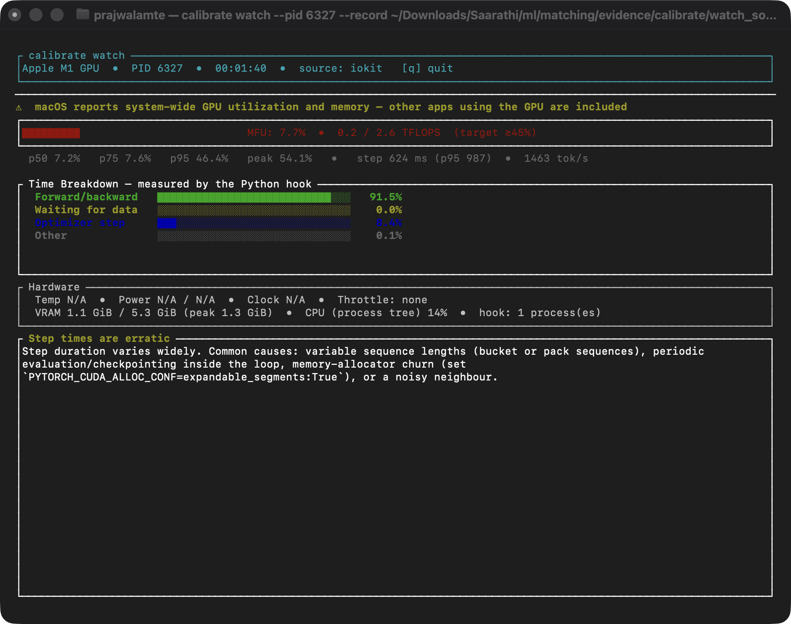
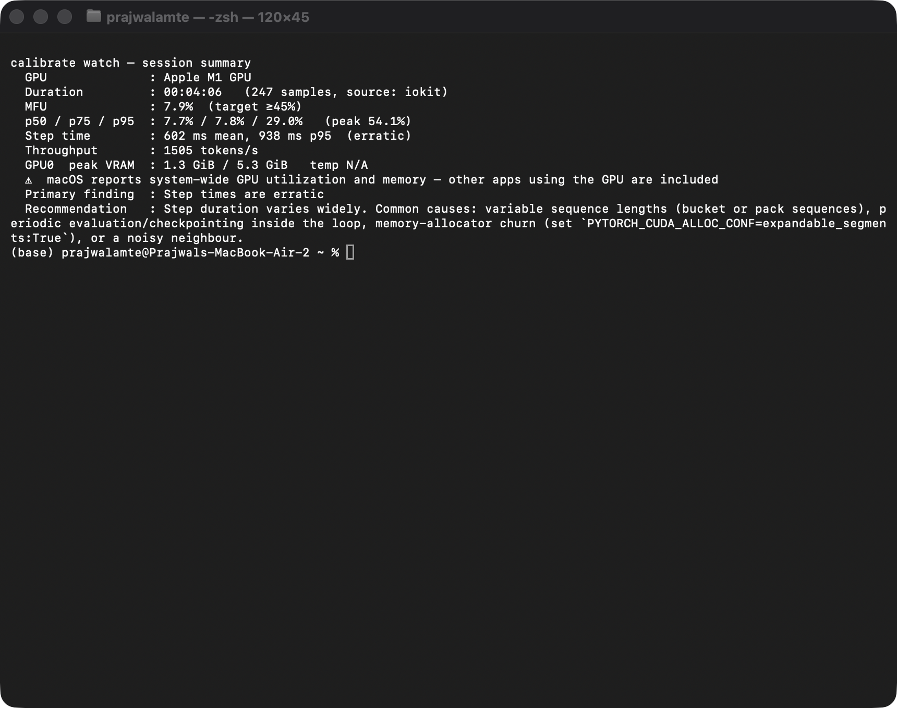

# Calibrate on a real fine-tuning run

[Calibrate](https://github.com/PrajwalAmte/Calibrate) v0.2.0 watching Saarthi's place-matching
cross-encoder being fine-tuned, on 5 November 2026.

**Setup:** MacBook Air, Apple M1, 8 GB. MiniLM-L6 (22.6M parameters), Rust with Burn 0.22 on Metal,
batch size 32, 400 steps. The trainer speaks Calibrate's hook protocol v1 directly from Rust
(`train/src/hook.rs` in the Saarthi project, not included here), so this also tests the protocol's claim
that any language can use it.

## Screenshots

These are real captures of Calibrate running in macOS Terminal.

| Live view, 1 min 40 s into a run | End of run |
| --- | --- |
|  |  |

A [capture earlier in the same run](screenshots/watch-live-early.png) and
[the summary a session under 30 seconds gets](screenshots/short-session-summary.png) are also here.

## What Calibrate found

From the full session on the soft-label run, the only one Calibrate watched from the start.

| Measure | Result |
| --- | --- |
| MFU source | `instrumented`, from the Rust trainer's hook |
| MFU, full run | 7.9% (p50 7.7%), target 45%. The "peak 54.1%" and p95 29% shown were a bug (see below) |
| GPU reported busy | About 95% of the time (system-wide) |
| Time breakdown | 91.5% forward and backward, 8.4% optimizer, 0.0% waiting for data |
| Step time | 602 ms mean, 938 ms p95, flagged erratic |
| Peak memory | 1.3 GiB of 5.3 GiB (system-wide) |
| Throughput | 1,505 tokens/s |

The main result is the gap between about 95% busy and 7.9% MFU. On GPU utilisation alone, this run looks
healthy. The 0.0% data wait also rules out the input pipeline as the bottleneck.

## Testing its advice

Calibrate said erratic steps commonly come from variable sequence lengths, among other causes. To test
that, each setting ran three times for 150 steps, alternating so that the Mac warming up affected each
equally. Raw results are in [experiment/](experiment/).

| Setting | Seconds per run | Mean | MFU | Samples/s | Step-time CV |
| --- | --- | --- | --- | --- | --- |
| Variable length, watched | 90, 91, 101 | 94 | 7.0–7.8% | 48–53 | 0.43–0.67 |
| Padded to 48 tokens, watched | 100, 91, 112 | 101 | 9.9–14.2% | 43–53 | 0.42–0.61 |
| Variable length, not watched | 65, 92, 60 | 72 | not measured | not measured | not measured |

- **Fixed length did not help.** Steps stayed erratic, and runs were no faster. *Caveat found in review:*
  v0.2.0 counted the slow warm-up steps when judging "erratic". On a reproduction with constant token
  counts, a 2.2 s first step before steady 45 ms steps gave CV 1.28 and an "erratic" finding by itself.
  So these runs may not have been erratic at all. Re-run with `--record-raw` on the fixed build to settle it.
- **MFU rose while useful work did not.** Padding raised MFU by about 60%, but samples per second did not
  rise. The trainer declares padded tokens as work, so MFU counted the padding. MFU only means what the
  declared FLOPs mean.
- **Watching may slow training.** Watched runs took about 30% longer, but one unwatched run (92 s) was as
  slow as the watched ones. Three runs each cannot settle this, so it needs a larger test. Heat could
  also play a part, since this Mac has no fan. *Measured in review:* `calibrate watch` itself used about
  1.5% of one core and 19 MB over 20 s, so its own collection work is not a likely cause.

## Issues found in Calibrate

Status after review. All fixes are listed in the repository's CHANGELOG under "Unreleased".

| Issue | Where | Verdict | Status |
| --- | --- | --- | --- |
| Heading says "measured by the Python hook" with a Rust hook attached | `watch` live view | Real bug | Fixed: "measured by the training hook" |
| Advice names `PYTORCH_CUDA_ALLOC_CONF` on an Apple GPU and a non-PyTorch job | `watch` recommendation | Real bug | Fixed: advice follows the device and the hook's `framework` |
| "Throttle: none" while throttling cannot be seen | `watch` live view | Real bug (also exported as 0 to Prometheus) | Fixed: N/A, `null` in JSON |
| "Optimizer step" is dark blue on a dark background | `watch` live view | Real bug | Fixed: light blue |
| Advice repeats the same text whether or not it applies | `watch` recommendation | Real bug, with a deeper cause: the warm-up step alone could trigger "erratic" | Fixed: warm-up excluded, robust test, advice says when sequence length is ruled out |
| Padded tokens raise MFU with no gain in throughput | Hook docs | Not a code bug (the GPU does compute padding), but the docs taught counting padding | Fixed: docs count non-padding tokens; TUI shows samples/s |
| "0.00B tokens", "0.02B" parameters | `plan` | Real bug | Fixed: "1.24M tokens", "22.6M parameters" |
| 0.79 GiB of "CUDA context"; only cloud GPUs | `plan` | Overhead label/amount: real bug. Local Mac: already possible with `--prices-file` | Fixed overhead for Apple GPUs; local planning documented in docs/configuration.md |
| "peak 54.1%", p95 29% (not listed above, found in review) | `watch` statistics | Real bug: busy time from before the hook's first steps leaked into measured MFU stats | Fixed |

## What worked well

- `diagnose` passed cleanly on this Mac ([diagnose.txt](diagnose.txt)).
- A Rust trainer connected with no changes to Calibrate, using only the documented protocol.
- Figures were labelled by their source, including the warning that macOS GPU figures are system-wide.
- `--record` kept a complete session ([watch_soft.jsonl](watch_soft.jsonl)).

## Files

- `train_hard.log`, `train_soft.log`: training output.
- `watch_soft.jsonl`: the full 4-minute session, one snapshot per second.
- `watch_hard.jsonl`: only the last 15 seconds of that run, because Terminal was slow to open.
- `experiment/`: logs and snapshots for all nine runs, with `summary.json`.

Hostnames in the logs are replaced with `HOST`. The screenshots show the macOS username and hostname.
